# TGHarbor

[English](../../README.md)

**可自托管、可恢复的 Telegram 下载与共享归档管理工具。**

TGHarbor 接收发送或转发给私有 Bot 的媒体，也可通过独立授权的用户账号处理该账号本来就能访问的单条 Telegram 消息链接。服务以 SQLite 持久化下载任务，把文件安全写入本地 Inbox，并允许授权用户通过 Bot 命令和内联按钮整理共享文件库。

> 项目处于早期开发阶段。升级前请备份状态；v1.0 之前配置和内部 API 可能发生变化。

## 主要功能

- **受限媒体，按授权保存：** TGHarbor 通过运维者已授权的 Telegram 账号会话以 MTProto
  下载，因此可以保存该账号本来就能访问的媒体，包括 Telegram 客户端标记为
  `禁止保存`、`禁止转发` 或 `无法转载` 的内容。它绝不绕过 Telegram 权限，也不会获取
  该账号无法访问的内容。
- 双 Telegram 客户端：Bot 接收媒体，用户会话处理单条消息链接。
- 请求者范围内的持久任务、进度、取消、重试及重启恢复。
- 有界元数据：最多 160 字的可读消息摘要、文件名、MIME 类型和文件大小。
- 共享 `inbox/` 与 `archive/`，支持可持久化的保留、重命名、归档和创建目录操作。
- 防止路径越界、符号链接和静默覆盖的冲突安全本地存储。
- SQLite schema 1 到 2 的事务迁移及旧 UUID 目录对账。
- 非 root Python 3.15 容器部署和安全检查 CI。

## 使用方法



TGHarbor 支持两种提交方式：

1. **可转发媒体：** 将一条包含文件的 Telegram 消息转发给私有 TGHarbor Bot。
2. **消息无法转发：** 复制该单条消息受支持的 `https://t.me/...` 链接，并只把该链接发送给 Bot。

只有配置中授权的用户才能提交。消息链接通过运维者已授权的 Telegram 用户会话解析，因此只能获取该账号本来就能访问的内容；TGHarbor 不会绕过 Telegram 权限。

## 开发

环境准备、检查、启动及配置方式见[开发准备](0-foundation/001-development-setup.md)。

## 容器镜像发布

公开镜像位于 [Docker Hub](https://hub.docker.com/r/shareur/tgharbor) 的 `shareur/tgharbor` 仓库。`0.2.1` 发布版本支持 `linux/amd64` 与 `linux/arm64`，发布标签为 `0.2.1`、`0.2`、`latest` 和 `sha-13c5bc7645b9`。多平台镜像索引为 `sha256:b40996ef4938f8545e5eaee86c91fc57b3d27f9b087353d02a97ae7548c5f560`，源码 revision 为 `13c5bc7645b9ba27ea9837be3697fa1388ffb44d`，来源为 `https://github.com/shareur/TGHarbor`。

标签只是可变别名。部署时应固定 `0.2.1`（不要使用 `latest`），并在上线前核对解析后的 `RepoDigest` 及 `org.opencontainers.image.version`、`.revision`、`.source` 标签与发布记录一致。发布工作流会在对应 tag-push CI 成功后发布稳定标签，并记录 Buildx provenance 与 SBOM。本地源码构建仍可用于开发，但不属于发布镜像。

直接使用 Docker Hub 镜像时，复制示例文件后拉取并启动：

```bash
cp compose.example.yaml compose.yaml
cp config.example.yaml config.yaml
cp .env.example .env
chmod 600 .env
chmod 644 config.yaml
docker compose pull
docker compose run --rm tgharbor login
docker compose up -d
```

`chmod 600 .env` 限制凭据访问；`chmod 644 config.yaml` 让宿主拥有的文件仍可被容器的非 root UID/GID `10001` 读取。

镜像入口点为 `tgharbor`，默认命令为 `run`；上述 `login` 命令仅用于首次授权用户会话。备份、恢复及可选宿主 bind mount 步骤见运维指南。

## 当前状态

v0.2 共享文件库工作流已实现，并由不含真实凭据的自动化测试覆盖。真实 Telegram、容器镜像、迁移演练和部署验收仍依赖运维者自有基础设施，不能从单元测试结果推定已经通过。

## 文档导航

| 分类 | 文档 |
| --- | --- |
| 0 — 基础 | [001 — 开发准备](0-foundation/001-development-setup.md) · [002 — 功能概览](0-foundation/002-feature-overview.md) · [003 — Bot 命令参考](0-foundation/003-command-reference.md) · [004 — 隐私与数据保留](0-foundation/004-privacy-and-retention.md) |
| 1 — 架构 | [101 — 系统架构概览](1-architecture/101-system-overview.md) · [102 — 文件目录与交互](1-architecture/102-file-catalog-and-interactions.md) |
| 2 — 实现 | [201 — v0.1 核心下载器](2-implementation/201-v0-1-core-downloader.md) · [202 — v0.2 文件库工作流](2-implementation/202-v0-2-library-workflow.md) |
| 3 — 运维 | [301 — 核心下载器运维](3-operations/301-core-downloader-operations.md) · [302 — 发布安全](3-operations/302-release-security.md) · [303 — v0.2 升级与回滚](3-operations/303-v0-2-upgrade.md) |

- `0-foundation/`（`001`–`099`）：产品范围、术语、开发准备、命令参考、隐私与贡献指南。
- `1-architecture/`（`101`–`199`）：公开组件概念、数据类别、授权边界及可观察的运维保证。
- `2-implementation/`（`201`–`299`）：发布范围、排除项、验收标准及验证证据。
- `3-operations/`（`301`–`399`）：部署、配置、监控、备份与恢复、升级与回滚、发布验证及故障排查。

英文是权威版本。中文译文在 `docs/zh-CN/` 下保持同名文件和目录结构，并与英文版本同步更新，维护双向语言链接。根项目 README 对应 `zh-CN/README.md`，该文件同时作为中文文档索引。索引文件不编号。

文档使用 `Nxx-topic-name.md` 命名，其中 `N` 为分类、`xx` 从 `01` 开始。已发布编号保持稳定且不复用；新增文档使用下一个可用编号。编号标识文档，不代表执行顺序。每个文档只讨论一个主题，相关材料通过链接引用而不是重复。仅在实际新增文档时创建目录，并在新增、移动或删除文档时更新导航和受影响链接。编排规则见[英文文档导航](../README.md)。

## 维护约定

仅在实际新增文档时扩展分类；避免空占位和重复主题，并保持示例与命令说明和可观察行为一致。
任务完成时同步更新受影响的英文文档、已有中文译文及导航；若共享文档不受影响，则无需仅为修改而改写。文档同步属于任务完成条件。

## 致谢

TGHarbor 是独立实现的项目，其工作流和使用场景受到现有 Telegram 下载项目的启发，包括 `jsavargas/telethon_downloader`。

## 许可证

Apache License 2.0。
